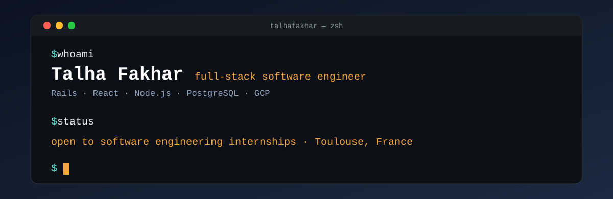
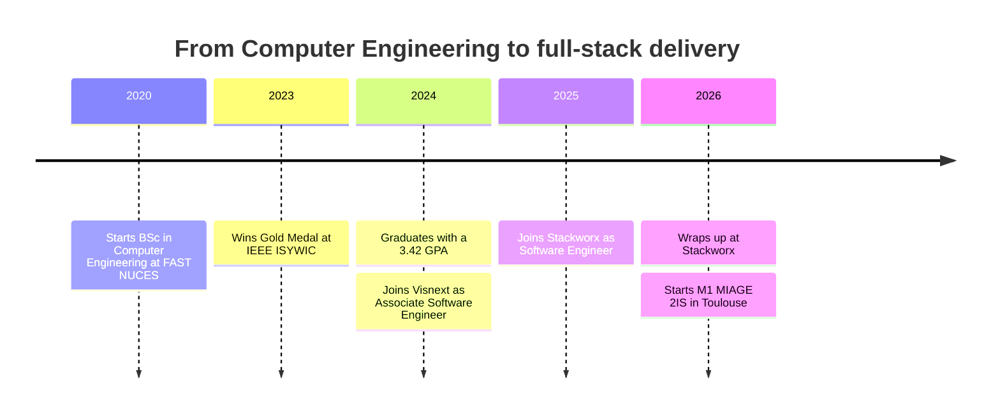
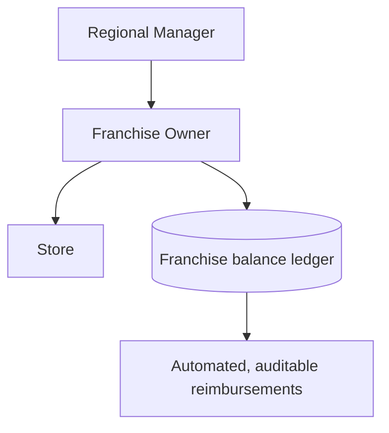

  
  
  
  

  
  
  

---

## `01` About

Full-stack software engineer with **2+ years** of experience building scalable, high-performance web applications with **Ruby on Rails** and the **MERN stack** (Node.js, Express, React). I'm strongest where the data model matters: relational design on **PostgreSQL and MySQL**, RESTful APIs, **financial and ledger systems**, authentication with **Auth0**, and deployments on **Google Cloud Platform**.

I'm currently doing my M1 Master's in **Innovative Information Systems** at **Université Toulouse Capitole**, and I'm looking for a software engineering internship.

<table align="center">
  <tr>
    <td align="center" width="25%"><h2>2+</h2>years building production web apps</td>
    <td align="center" width="25%"><h2>6</h2>client web apps delivered at Stackworx</td>
    <td align="center" width="25%"><h2>5x</h2>Dean's List at FAST NUCES</td>
    <td align="center" width="25%"><h2>3.42</h2>GPA on a 4.00 scale</td>
  </tr>
</table>

## `02` Journey

## `03` Experience

### Software Engineer · Stackworx
Oct 2025 – Aug 2026

Delivered **6 client web applications** using Ruby on Rails, React and Node.js for sports, franchise, nonprofit, media, freight and real-estate clients.

<table>
  <tr>
    <td width="50%" valign="top">
      <h4>LoadBetter</h4>
      Co-architected a real-time freight-matching marketplace connecting 3 user roles: Shippers, Brokers and Carriers. Implemented transactional bidding on an optimized PostgreSQL schema built for high-concurrency state transitions.  
        
    </td>
    <td width="50%" valign="top">
      <h4>Flip</h4>
      Designed and delivered a property management app with relational data models and optimized API endpoints for hierarchical, multi-property data. Owners can initialize, budget and track capital improvement projects across assets.  
       
    </td>
  </tr>
  <tr>
    <td width="50%" valign="top">
      <h4>ShadowBox Studios</h4>
      Built a cinematic marketing website, a custom web app and an admin panel for a premium film and TV sound-stage operator with 4 international campuses (UK, USA, Australia, Jordan).  
       
    </td>
    <td width="50%" valign="top">
      <h4>RMR Tim Hortons</h4>
      Built a 3-tier hierarchy mapping stores, Franchise Owners and Regional Managers. Engineered a ledger system for franchise balances and automated, auditable financial reimbursements.  
      
    </td>
  </tr>
  <tr>
    <td width="50%" valign="top">
      <h4>Smile Cookie Platform</h4>
      Designed the architecture of a high-volume CSR grant application with multi-stage approval workflows that Regional Managers handle asynchronously.  
      
    </td>
    <td width="50%" valign="top">
      <h4>Timbits Sports</h4>
      Developed a dual-portal (Admin and Customer) monolith that streamlined order processing, material logistics and kit configuration for regional youth soccer and hockey leagues.  
      
    </td>
  </tr>
</table>

<b>Sketch: how the RMR Tim Hortons hierarchy fits together</b>

### Associate Software Engineer · Visnext Software Solutions
Jul 2024 – Oct 2025

<table>
  <tr>
    <td width="50%" valign="top">
      <h4>My Money Matters</h4>
      Co-developed a financial wellbeing application, building features across 2 backend frameworks: Ruby on Rails and Node.js / Express.  
         
    </td>
    <td width="50%" valign="top">
      <h4>Custom Audit Log Engine</h4>
      Engineered a custom Node.js package that tracks system-wide financial and data mutations.  
       
    </td>
  </tr>
  <tr>
    <td width="50%" valign="top">
      <h4>Auth0 Identity Pipeline</h4>
      Architected a secure authentication and authorization pipeline by integrating Auth0 into the Rails backend.  
       
    </td>
    <td width="50%" valign="top">
      <h4>Cloud Infrastructure and DevOps</h4>
      Deployed containerized applications on Google Cloud Run and managed infrastructure on Compute Engine.  
       
    </td>
  </tr>
  <tr>
    <td colspan="2" valign="top">
      <h4>Frontend Engineering</h4>
      Translated complex Figma designs into responsive, pixel-perfect layouts, and contributed to Agile sprints, cross-functional collaboration and code reviews.  
        
    </td>
  </tr>
</table>

## `04` Personal projects

<table>
  <tr>
    <td width="33%" valign="top">
      <h4>Audit Logger</h4>
      A decoupled middleware package, published on npm, that captures structural data mutations and financial state history in MERN apps. Built for plug-and-play use across backend architectures.  
        
    </td>
    <td width="33%" valign="top">
      <h4>Distributed Payment Ledger and Escrow Microservice</h4>
      A standalone, multi-tenant, escrow-style financial microservice with secure webhook handling for multi-party payouts, automated ledger reconciliation and strict data isolation to protect transaction integrity.  
        
    </td>
    <td width="33%" valign="top">
      <h4>Bug Tracking System</h4>
      A project management and issue-tracking web app with real-time ticket state transitions, team-wide assignment metrics and sprint progress visualizations.  
       
    </td>
  </tr>
</table>

## `05` Tech stack

  

| Area | Tools |
|---|---|
| **Languages** | JavaScript, Ruby, SQL |
| **Frontend** | React.js, HTML5, CSS3 |
| **Backend** | Ruby on Rails (MVC and API-only), Node.js, Express.js, RESTful API design, Microservices |
| **Databases** | PostgreSQL, MySQL, Oracle SQL |
| **Cloud and DevOps** | Google Cloud Platform (Cloud Run, Compute Engine), Git / GitHub |
| **Ways of working** | Agile sprints, code reviews, cross-functional collaboration |

## `06` Education and recognition

| | |
|---|---|
| **Master's, MIAGE 2IS (Innovative Information Systems)** | Université Toulouse Capitole, Toulouse, France · 2026 – present |
| **Bachelor's of Electrical Engineering (Computer Engineering)** | FAST NUCES · 2020 – 2024 · GPA 3.42 / 4.00 |
| **Awards** | Gold Medal, IEEE ISYWIC (2023) · Dean's List, 5 times, FAST NUCES |
| **Certifications** | Introduction to Relational Databases and SQL · Google AI Essentials · Introduction to Machine Learning |

## `07` GitHub activity

  
  

## `08` Let's talk

I'm looking for a **software engineering internship** where I can work on full-stack products, ideally with a team that cares about solid data models and reliable APIs. If that sounds like yours, I'd love to hear from you.

  
  
  
  

